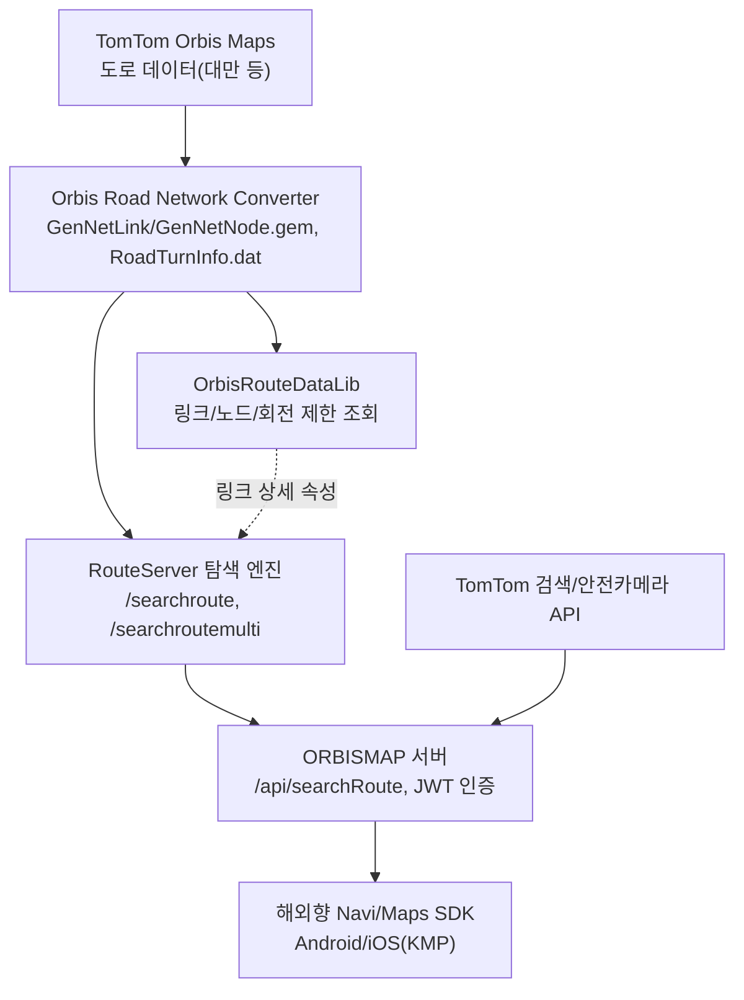

# Orbis 경로탐색 스택 구조

해외향 서비스([[orbis-sdk]])가 쓰는 경로탐색 구조를 문서 세 편에서 이어 붙여 그렸다. 문서에는 전체 그림이 한 번에 나오지 않아 연결 부분은 추론이다.

## 계층

| 계층 | 역할 | 문서 |
|---|---|---|
| 도로 데이터 | TomTom Orbis Maps의 OSM 계열 링크/노드 | |
| 네트워크 변환기 | 원본을 탐색용 `.gem`/`.dat`로 변환, 자체 ID index 부여 | [[orbis-route-data-lib]] |
| 데이터 라이브러리 | 링크/노드/회전 제한/도로명 조회(C++, Android) | [[orbis-route-data-lib]] |
| 탐색 서버 | 엔진·데이터·라이브러리 버전별 포트 분기, GeoJSON 경로 | [[taiwan-routeserver-api]] |
| 서비스 서버 | 인증(JWT), 서비스 게이트, 경로 프록시, TomTom 검색 프록시 | [[orbismap-api-docs]] |
| 클라이언트 | SDK | [[orbis-sdk]] |

## 국내 스택과 비교

| 항목 | 국내(에어) | 해외(Orbis) |
|---|---|---|
| 지도 데이터 | MR, sMR 자체 포맷 ([[inavi-mr-smr-network-data]]) | TomTom Orbis를 변환한 `.gem`/`.dat` |
| 탐색 프로토콜 | 바이너리 패킷 ([[inavi-routing-neon-protocol]]) | HTTP + JSON(GeoJSON 경로) |
| 서버 API | `INaviAir` 약 140개 ([[inavi-air-api-detail-spec]]) | ORBISMAP 17개 |
| 인증 | 개인키/인증키 헤더 | JWT Bearer |
| 부가정보(검색, 안전카메라) | 자체 서버 | TomTom API 프록시 |
| 차량 용도 | 트럭 중량/높이 제한, 차량 용도 | 중량/높이/길이/전폭/위험물 ([[vehicle-restriction-routing]]) |

## 해석

- 두 스택 모두 **같은 경로기술개발팀**이 엔진 프로토콜을 관리한다(국내는 Neon, 해외는 RouteServer). 데이터 포맷만 갈아 끼우고 탐색 옵션 개념(교통정보 적용, 출발지 방향성, 차량 제원, 경유지 처리)은 이어지는 구조로 보인다. ^[inferred]
- 국내 Neon 프로토콜의 `directionangle`에 해당하는 "출발지 각도 사용 프로젝션"(v1.8, 2020), 차량 용도별 탐색(v2.1.6, 2021)이 해외 규격에도 같은 이름과 개념으로 나타난다. ^[inferred]
- 서비스 게이트의 `smr_ver` 같은 필드는 국내 앱 API의 서비스 게이트 구조와 같다. 국내 서버 구현을 해외 서버가 재사용했을 가능성이 있다. ^[inferred]

## 해외 SDK 개발자 관점에서

SDK가 신경 쓰는 경계는 ORBISMAP API다. 경로 요청 옵션이 탐색 서버 규격보다 늦게 따라가므로(Swagger에 `width`/`hazmat` 없음), SDK의 트럭향 기능을 확장할 때는 **서버 쪽 Swagger 반영 여부**를 먼저 확인해야 한다. ^[inferred]

## Open Questions

- Orbis Road Network Converter 자체는 문서가 없다.
- 탐색 서버와 ORBISMAP 사이가 어떻게 연결되는지(ORBISMAP이 RouteServer를 호출하는지)는 문서에 직접 나오지 않는다. ^[ambiguous]

## Sources

- INAVI RouteServer for Taiwan API 설명서(탐색 서버 API 규격 v2.3) — 서버 주소가 들어 있어 원본 PDF를 보안 사유로 삭제했다 (2026-10-26)
- [[_raw/_archived/INAVI_RouteServer_for_Taiwan_RouteDataLib_Guide_And_Reference_v1_0_1_4.pdf]] — 데이터 라이브러리
- [[_raw/_archived/ORBISMAP API DOCS (Agent, Swagger).md]] — ORBISMAP Swagger
